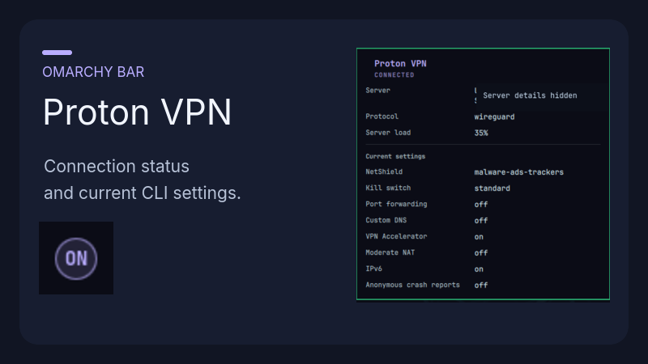

# Proton VPN for Omarchy

A read-only view of Proton VPN in the Omarchy bar. The badge shows the connection state at a glance. Open it to see the server, protocol, server load, and current settings from the official Proton VPN CLI.



## Install

Requires Omarchy 4.x with the Quickshell bar and the [official Proton VPN Linux CLI](https://protonvpn.com/support/use-linux-cli). Sign in to Proton VPN from your terminal first. The CLI must be on the desktop session's `PATH` and support `protonvpn status` and `protonvpn config list`.

```sh
omarchy plugin add https://github.com/CallMeBakugo/omarchy-protonvpn.git --enable
```

## Use

| Action | Result |
| --- | --- |
| Glance at the badge | **ON** when connected, **OFF** when disconnected, **…** while checking, or **?** when status is unavailable |
| Left-click | Open the connection and settings panel |
| Right-click, or press **R** in the panel | Refresh both readings |

The widget shares one 15-second status poller across monitors. It refreshes settings when the panel opens. NetShield, kill switch, VPN Accelerator, IPv6, DNS, NAT, and other supported values are shown as reported by the CLI. Manage your connection and settings from your terminal.

## Remove

```sh
omarchy plugin remove bakugo.protonvpn --yes
```

[MIT license](LICENSE).
